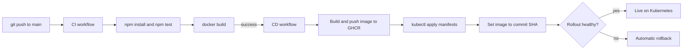

# GitHub Actions → Kubernetes CI/CD

[](https://github.com/iamohsin1273/github-actions-k8s-cicd/actions/workflows/ci.yml)
[](https://github.com/iamohsin1273/github-actions-k8s-cicd/actions/workflows/cd.yml)


A small, complete example of taking code from **commit to a running Kubernetes deployment** with GitHub Actions. A tiny Express app is tested, packaged into a container image, pushed to GitHub Container Registry (GHCR) and rolled out to a cluster, with automatic rollback if the rollout fails.

The app is intentionally minimal so the pipeline is the focus.

## How it works



| Workflow | Trigger | What it does |
|----------|---------|--------------|
| [`ci.yml`](.github/workflows/ci.yml) | Push or pull request to `main` | Installs dependencies, runs tests, builds the Docker image (without pushing) |
| [`cd.yml`](.github/workflows/cd.yml) | CI finished successfully on a push to `main` | Pushes the image to GHCR tagged with the commit SHA and `latest`, applies the manifests, updates the Deployment image, waits for the rollout and rolls back on failure |

The deploy job only runs when a `KUBE_CONFIG` secret exists. Without it the image is still built and published and the deploy step is skipped with a notice, so the repository works before you have a cluster.

## Project structure

```
.
├── app/
│   ├── server.js              # Express app (GET /, GET /health)
│   ├── package.json
│   └── test/app.test.js       # Tests using Node's built-in test runner
├── k8s/
│   ├── namespace.yaml         # devops-demo namespace
│   ├── deployment.yaml        # 2 replicas, probes, resource limits, rolling update
│   ├── service.yaml           # ClusterIP service on port 80
│   └── ingress.yaml           # NGINX ingress routing / to the service
├── scripts/
│   ├── build.sh               # Build the image locally
│   ├── deploy.sh              # Apply manifests and wait for rollout
│   └── rollback.sh            # Roll back to the previous revision
├── .github/workflows/
│   ├── ci.yml
│   └── cd.yml
├── Dockerfile                 # Non-root image with a health check
└── .dockerignore
```

## The app

| Endpoint | Response | Purpose |
|----------|----------|---------|
| `GET /` | `DevOps CI/CD Pipeline Running` | Confirms the app is serving |
| `GET /health` | `OK` (HTTP 200) | Used by Docker and by Kubernetes readiness and liveness probes |

The port defaults to `3000` and can be changed with the `PORT` environment variable. The server shuts down gracefully on `SIGTERM`, so rollouts do not drop in-flight requests.

## Run it locally

**With Node.js 20+**

```bash
cd app
npm install
npm test
npm start            # http://localhost:3000
```

**With Docker**

```bash
./scripts/build.sh                      # builds devops-demo:local
docker run --rm -p 3000:3000 devops-demo:local
curl localhost:3000/health              # OK
```

## Deploy to your own cluster

### 1. Prerequisites

- A Kubernetes cluster you can reach with `kubectl` (a managed cluster, k3s, kind or minikube all work)
- An NGINX ingress controller if you want to use the Ingress (`ingressClassName: nginx`)

### 2. Check the image name

[`k8s/deployment.yaml`](k8s/deployment.yaml) points at `ghcr.io/iamohsin1273/github-actions-k8s-cicd`. If you fork the repository, change `iamohsin1273` to your GitHub username.

### 3. Add the cluster credentials as a secret

Encode your kubeconfig and save it as a repository secret named `KUBE_CONFIG` (Settings → Secrets and variables → Actions):

```bash
# Linux
base64 -w0 ~/.kube/config

# macOS
base64 -i ~/.kube/config | tr -d '\n'
```

Use a kubeconfig whose credentials are limited to the `devops-demo` namespace where possible, not cluster admin.

### 4. Let the cluster pull the image

New GHCR packages are private. Either:

- make the package public (Profile → Packages → `github-actions-k8s-cicd` → Package settings → Change visibility), or
- create an image pull secret and reference it from the Deployment:

  ```bash
  kubectl -n devops-demo create secret docker-registry ghcr-pull \
    --docker-server=ghcr.io --docker-username=<github-user> --docker-password=<token-with-read:packages>
  ```

  then add `imagePullSecrets: [{name: ghcr-pull}]` under `spec.template.spec` in the Deployment.

### 5. Push to `main`

CI runs first. When it passes, CD publishes the image and deploys it. Watch progress in the **Actions** tab, or from the terminal:

```bash
kubectl -n devops-demo get pods,svc,ingress
kubectl -n devops-demo rollout status deployment/devops-demo
```

### Deploying manually

```bash
./scripts/deploy.sh      # applies the namespace first, then everything else
```

## Rollbacks

The pipeline rolls back automatically when `kubectl rollout status` fails. To roll back by hand:

```bash
./scripts/rollback.sh
```

Every image is tagged with its commit SHA, so you can also redeploy a known good version:

```bash
kubectl -n devops-demo set image deployment/devops-demo app=ghcr.io/<owner>/github-actions-k8s-cicd:<commit-sha>
```

## Kubernetes details

- **Zero-downtime rollouts:** `maxUnavailable: 0` and `maxSurge: 1`, with a readiness probe on `/health`
- **Self-healing:** liveness probe restarts a stuck container
- **Resource limits:** CPU and memory requests and limits are set
- **Hardened container:** runs as a non-root user with privilege escalation disabled

## Troubleshooting

| Symptom | Likely cause and fix |
|---------|----------------------|
| `ImagePullBackOff` | The GHCR package is private. Make it public or add an image pull secret (step 4) |
| CD finishes but nothing deploys | The `KUBE_CONFIG` secret is missing. The workflow log shows a notice when the deploy step is skipped |
| `error: You must be logged in` or auth errors in CD | The kubeconfig is expired or not base64-encoded as a single line |
| Ingress has no address | No ingress controller is installed, or its class is not `nginx` |
| CD does not start | CD only runs after a successful CI run on a push to `main`, not for pull requests |

## Ideas for next steps

- Commit a `package-lock.json` (run `npm install` in `app/`) and switch the workflow and Dockerfile to `npm ci` for fully reproducible builds
- Add image vulnerability scanning (for example Trivy) between build and push
- Add a staging environment with a manual approval before production
- Manage the manifests with Helm or Kustomize

## License

No license file is included yet. Add one (for example MIT) if you want others to reuse this project.
